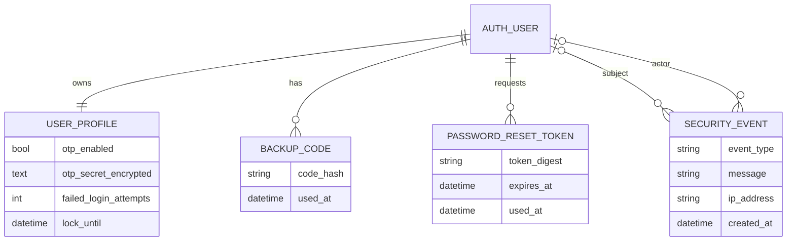
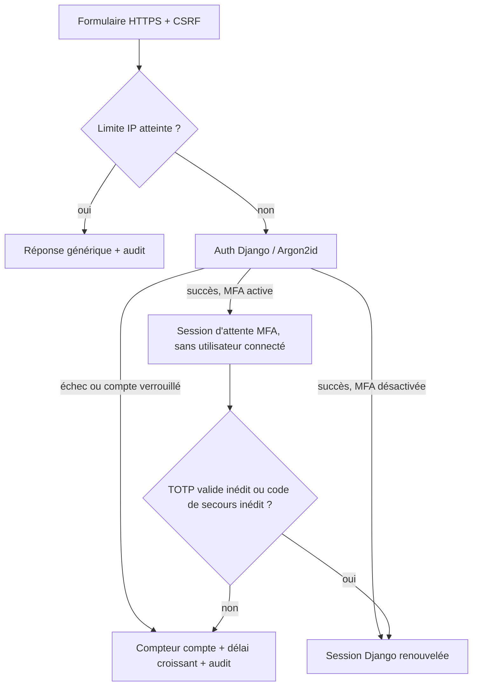

# SecureAuth — authentification sécurisée

Projet individuel de 2e année : une application de comptes Django utilisant SQLite, avec authentification, gestion de profil, MFA et fonctions d’administration. Le code est une base pédagogique à expliquer, tester et auditer ; ne pas l’exposer sur Internet sans configuration de production, revue indépendante et gestion de secrets appropriée.

## Fonctionnalités réalisées

- Inscription, validation serveur, unicité du nom et de l’e-mail, mots de passe robustes.
- Hachage Argon2id via le hasher Django ; les mots de passe ne sont jamais journalisés.
- Sessions Django, cookie HttpOnly/SameSite, expiration après 30 minutes d’inactivité ; cookie Secure en HTTPS.
- Connexion avec une réponse générique, verrouillage par compte à durée exponentielle et limitation par IP.
- Consultation/modification du profil et changement du mot de passe avec vérification de l’ancien.
- MFA TOTP, QR code produit localement, protection du secret TOTP au repos avec Fernet et code dérivé de `DJANGO_SECRET_KEY`.
- Codes de secours stockés hachés et consommés une seule fois ; rejet de la réutilisation d’un code TOTP.
- Réinitialisation via lien aléatoire à usage unique, durée de 30 minutes, seul le SHA-256 du jeton est stocké. L’e-mail est capturé localement.
- Rôle administrateur basé sur `is_staff`, appliqué dans les vues ; recherche, désactivation/réactivation, suppression et envoi de reset.
- Journal d’audit avec horodatage, IP, acteur/compte concerné ; filtres côté admin et aucune valeur de mot de passe, TOTP ou jeton dans le journal.
- CSRF Django, ORM, échappement des templates, CSP, X-Frame-Options et protections de cookies.

## Démarrage Windows (local)

PowerShell, depuis le dépôt :

```powershell
py -m venv .venv
.\.venv\Scripts\python.exe -m pip install -r requirements.txt
.\.venv\Scripts\python.exe manage.py migrate
.\.venv\Scripts\python.exe manage.py createsuperuser
.\.venv\Scripts\python.exe manage.py runserver
```

Ouvrir <http://127.0.0.1:8000/>. Les e-mails de réinitialisation s’affichent dans la console. La MFA se configure depuis l’espace utilisateur : scanner le QR code local avec une application TOTP, puis saisir le code et le mot de passe. Les codes de secours ne s’affichent qu’une fois.

La `SECRET_KEY` de secours dans les paramètres est uniquement un secret de développement. En production, l’application refuse de démarrer sans `DJANGO_SECRET_KEY` ; définir aussi `DJANGO_DEBUG=false`, `DJANGO_ALLOWED_HOSTS`, `PUBLIC_BASE_URL` et les origines CSRF exactes. Conserver la même clé durablement : elle chiffre les secrets TOTP. Si elle est perdue ou remplacée sans rotation organisée, les secrets TOTP existants ne pourront plus être déchiffrés. En production, les cookies Secure, HTTPS redirect et HSTS sont activés lorsque `DEBUG=False`.

## Docker Compose et HTTPS local

Docker Compose démarre l’application, Caddy avec certificat local et Mailpit (SMTP/UI de test) :

```powershell
docker compose up --build
```

Visiter <https://localhost:8443/> ; le navigateur avertira du certificat d’autorité local Caddy jusqu’à ce que tu l’ajoutes comme autorité de confiance sur ta machine. L’interface Mailpit est sur <http://localhost:8025/>. Seuls des e-mails fictifs de test doivent être utilisés. Les volumes `sqlite_data` et `caddy_data` conservent la base et l’autorité locale entre redémarrages.

Pour les comptes d’administration dans le conteneur :

```powershell
docker compose exec web python manage.py createsuperuser
```

## Tests et contrôles

```powershell
.\.venv\Scripts\python.exe manage.py check
.\.venv\Scripts\python.exe manage.py makemigrations --check --dry-run
.\.venv\Scripts\python.exe manage.py test
```

Les tests couvrent inscription, hachage Argon2, sessions/CSRF, erreurs de connexion uniformes, verrouillage et limitation IP, isolement du profil, réauthentification, MFA/rejeu/codes de secours/chiffrement, reset expiré/à usage unique et contrôle d’accès administrateur.

### Schéma de données simplifié



### Flux connexion



### Menaces et mesures

| Menace | Mesure implémentée | Test/contrôle |
|---|---|---|
| Vol de mots de passe en base | Argon2id Django avec sel | Vérification du format stocké |
| Énumération des comptes via login/reset | Message de login générique, confirmation reset uniforme | Tests d’erreur générique |
| Force brute distribuée ou locale | Temporisation croissante par compte et seuil d’IP | Tests de verrouillage et throttling |
| Vol/réutilisation de code MFA | TOTP avec compteur consommé et codes de secours à usage unique | Tests de rejeu |
| Vol de secret MFA en base | Chiffrement Fernet dérivé de la clé applicative | Test de chiffrement au repos |
| CSRF, XSS et injection | Middleware/token CSRF, auto-échappement, ORM | Test CSRF, revue manuelle |
| Accès à un autre profil / abus admin | Profil déterminé exclusivement par la session, vues staff-only, mutations POST | Tests d’autorisation |
| Reset détourné/réutilisé | Token aléatoire, digest seul en base, expiration/consommation atomique | Tests d’expiration et usage unique |

### Cinq tests d’attaque documentés

1. **Mot de passe incorrect et utilisateur inconnu** : tenter les deux et comparer le message. Le message ne révèle pas l’existence du compte.
2. **Force brute** : cinq erreurs sur un compte actif puis essayer un mot de passe correct ; l’accès reste refusé pendant le verrouillage. Répéter depuis une même IP jusqu’au seuil configuré.
3. **Contournement MFA** : valider le mot de passe puis requêter directement `/dashboard/` ou réutiliser un ancien code TOTP ; la session n’est authentifiée qu’après le second facteur et le code ne peut être rejoué.
4. **CSRF** : poster un formulaire sans jeton CSRF avec un client de test ; Django renvoie 403.
5. **Accès non autorisé** : appeler une action d’administration comme utilisateur normal ou tenter une mutation via GET ; l’accès est redirigé/refusé et les mutations n’acceptent que POST.

### Auto-audit ZAP / vérification manuelle

Le scan ZAP n’est pas lancé automatiquement par cette application. Pour produire le livrable de scan, démarrer le Compose, configurer ZAP en mode local sur `https://localhost:8443`, accepter le certificat Caddy pour le proxy de test, explorer les pages de connexion/profil/MFA/reset/admin avec des comptes fictifs puis lancer le scan passif. Tester les contrôles actifs uniquement sur cette instance locale. Conserver le rapport et classer chaque alerte : faux positif, corrigé ou accepté avec justification. Refaire le scan après correction. La configuration HTTPS locale et les tests Django ne remplacent pas une revue ZAP ou une revue de code indépendante.

## Limites / améliorations possibles

Ce projet est pédagogique : le stockage des sessions utilise SQLite, l’audit en base n’est pas infalsifiable, la détection IP n’identifie pas un pays et les rôles restent volontairement simples (`is_staff`). L’application n’accepte `X-Forwarded-For` que depuis une IP déclarée dans `TRUSTED_PROXY_IPS` ; Compose fixe Caddy à `172.28.0.2` et remplace l’en-tête reçu du navigateur. Pour un autre proxy, configure explicitement son IP et fais-lui remplacer cet en-tête. Pour un déploiement réel, ajouter gestion/rotation de secrets, sauvegardes, base adaptée à la concurrence, surveillance d’alertes, vérification de mots de passe compromis, stratégie de récupération MFA et procédure de réponse aux incidents.

## Assistance par IA

L’assistance IA a servi à implémenter, expliquer et tester certaines parties du projet. L’étudiant doit relire et comprendre le code, compléter son journal conformément aux consignes et pouvoir justifier chaque choix en soutenance.
