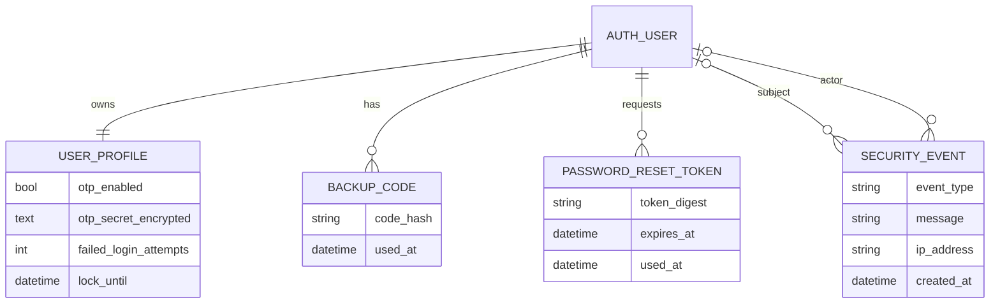
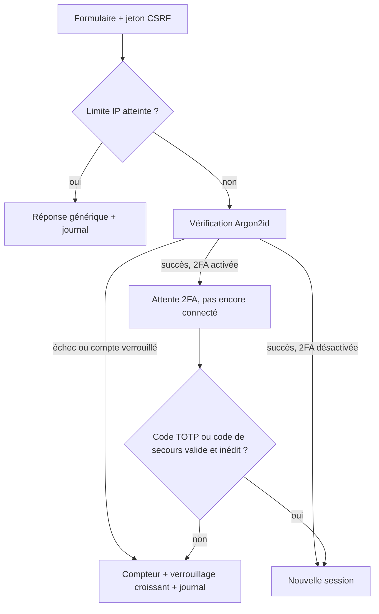

# SecureAuth — application web d'authentification sécurisée

Projet individuel de 2e année (Dev + Cyber). SecureAuth est un module de comptes
réutilisable : inscription, connexion, profil, double authentification (TOTP),
réinitialisation du mot de passe, espace administrateur et journal des
événements de sécurité. L'objectif n'est pas seulement qu'il fonctionne, mais
qu'il **résiste à de vraies attaques** et que cela soit **prouvé par des tests**.

- **Langage / framework** : Python 3.12 + Django 5.2
- **Base de données** : SQLite (fichier local `db.sqlite3`)
- **Hachage des mots de passe** : Argon2id

> Projet pédagogique : ne pas l'exposer sur Internet sans configuration de
> production et revue de sécurité.

---

## 1. Installation (pas à pas)

### Prérequis

- **Python 3.12** (vérifier avec `python --version` ou `py --version`)
- **Git**

### Étapes (Windows, PowerShell)

```powershell
# 1. Récupérer le projet
git clone https://github.com/YANIXX35/thoukou.git
cd thoukou

# 2. Créer un environnement virtuel (dossier .venv, propre au projet)
py -m venv .venv

# 3. Installer les dépendances (versions exactes dans requirements.txt)
.\.venv\Scripts\python.exe -m pip install -r requirements.txt

# 4. Créer la base SQLite et ses tables
.\.venv\Scripts\python.exe manage.py migrate

# 5. Créer un compte administrateur (nom, e-mail fictif, mot de passe >= 12 caractères)
.\.venv\Scripts\python.exe manage.py createsuperuser

# 6. Lancer le serveur
.\.venv\Scripts\python.exe manage.py runserver
```

Ouvrir ensuite <http://127.0.0.1:8000/> dans le navigateur.

### Étapes (macOS / Linux)

```bash
git clone https://github.com/YANIXX35/thoukou.git && cd thoukou
python3 -m venv .venv
.venv/bin/python -m pip install -r requirements.txt
.venv/bin/python manage.py migrate
.venv/bin/python manage.py createsuperuser
.venv/bin/python manage.py runserver
```

### Dépendances installées (`requirements.txt`)

| Paquet | Rôle |
|---|---|
| Django | Framework web : ORM (requêtes préparées), sessions, CSRF, templates échappés |
| argon2-cffi | Hachage Argon2id des mots de passe |
| pyotp | Codes TOTP de la double authentification |
| qrcode + pillow | QR code à scanner avec l'application d'authentification |
| cryptography | Chiffrement Fernet du secret TOTP stocké en base |
| tzdata | Fuseaux horaires (requis sous Windows) |

### Problèmes fréquents

| Erreur | Cause | Solution |
|---|---|---|
| `.\.venv\Scripts\python.exe n'est pas reconnu` | Le terminal n'est pas dans le dossier du projet | `cd` dans le dossier qui contient `manage.py` |
| `git add.` ne fonctionne pas | Espace manquant | `git add .` |
| Le commit échoue (« Please tell me who you are ») | Identité Git non configurée | `git config --global user.name "Nom"` puis `git config --global user.email "mail"` |
| Page « Interdit (403) — vérification CSRF » à la connexion | Ancienne page gardée par le navigateur | Fermer l'onglet et rouvrir `http://127.0.0.1:8000/login/` (corrigé, voir §3) |

---

## 2. Lancer les tests

```powershell
.\.venv\Scripts\python.exe manage.py check                         # configuration
.\.venv\Scripts\python.exe manage.py makemigrations --check --dry-run   # modèles = migrations
.\.venv\Scripts\python.exe manage.py test                          # 56 tests automatisés
```

Les tests couvrent : inscription et validation, hachage Argon2id, cookies de
session, CSRF, messages d'erreur identiques (pas d'énumération de comptes),
verrouillage par compte et limitation par IP, accès au profil d'autrui,
changement de mot de passe, 2FA (rejeu, codes de secours, chiffrement du secret),
réinitialisation (jeton expiré / à usage unique), contrôle d'accès administrateur,
journal de sécurité et en-têtes HTTP.

---

## 3. Ce que nous avons fait — journal de bord

### 16/10/2026 — Préparation de l'environnement et vérification

**Objectif** : préparer l'environnement, suivre le code avec Git et vérifier que
l'application fonctionne en local avec SQLite (sans Docker ni PostgreSQL).

**Réalisé :**

1. **Environnement** : Python 3.12.10 et Django 5.2.18 vérifiés, environnement
   virtuel `.venv` créé, dépendances installées.
2. **Git** : identité configurée (`git config user.name / user.email`), premier
   commit de référence, `.venv` et `db.sqlite3` exclus du dépôt (`.gitignore`).
3. **Vérification Django** :
   - `manage.py check` → aucune erreur ;
   - `makemigrations --check` → modèles et migrations cohérents ;
   - `migrate` → base SQLite créée ;
   - serveur lancé, pages contrôlées :

   | Page | Résultat |
   |---|---|
   | `/` | redirige vers `/login/` |
   | `/login/`, `/register/`, `/password_reset/` | 200 OK |
   | `/dashboard/` sans être connecté | redirige vers la connexion |
   | `/security-admin/users/` sans être connecté | redirige vers la connexion |

4. **Compte administrateur** créé avec `createsuperuser`, connexion réussie,
   l'événement « Connexion réussie » apparaît dans le journal avec date et IP
   (sans mot de passe).
5. **`requirements.txt`** : versions exactes figées et vérifiées dans un
   environnement neuf.

**Difficultés rencontrées et solutions :**

- `git add.` → il manque l'espace : `git add .`
- Commit impossible → identité Git non configurée, réglée avec `git config`.
- **Erreur 403 CSRF à la connexion** (« la valeur nulle ne correspond à aucune
  origine de confiance ») :
  - *Cause* : l'en-tête `Referrer-Policy: no-referrer` fait envoyer
    `Origin: null` par Chrome lors de l'envoi d'un formulaire ; le contrôle
    d'origine CSRF de Django refuse alors la requête. Les tests ne l'avaient pas
    vu car le client de test de Django n'envoie pas d'en-tête `Origin`.
  - *Correction* : passage à `Referrer-Policy: same-origin` (l'origine est
    envoyée à notre site, jamais aux sites externes : un lien de réinitialisation
    ne fuit toujours pas vers un autre site).
  - *Complément* : les pages HTML sont envoyées avec `Cache-Control: no-store`
    pour que le navigateur ne réutilise jamais un formulaire périmé (et ne garde
    pas de données personnelles en cache).
  - *Tests ajoutés* : en-tête `same-origin`, connexion « comme un navigateur »
    avec en-tête `Origin` acceptée, requête avec `Origin: null` toujours
    refusée, pages non mises en cache. **56 tests passent.**

**Prochaines étapes :** vérification complète du socle d'authentification,
schéma de base de données et schémas des flux, modèle de menaces (≥ 6 menaces),
5 tests d'attaque documentés.

---

## 4. Fonctionnalités présentes

- **Inscription** : validation côté serveur (e-mail valide, unicité, mot de passe
  ≥ 12 caractères, non courant, non uniquement numérique, différent du nom).
- **Mots de passe** : hachés avec Argon2id (sel aléatoire inclus), jamais en clair
  ni dans la base ni dans les logs.
- **Sessions** : cookie `HttpOnly`, `SameSite=Lax`, `Secure` en HTTPS, expiration
  après 30 min d'inactivité et à la fermeture du navigateur ; identifiant de
  session renouvelé à la connexion.
- **Connexion** : message d'erreur identique que le compte existe ou non ;
  redirection `next` limitée au site (pas de redirection ouverte).
- **Anti brute force** : verrouillage du compte après 5 échecs, durée croissante
  (5, 10, 20 min… jusqu'à 24 h) ; limitation à 20 échecs par IP sur 15 min.
- **Profil** : consultation / modification de ses propres informations ;
  changement de mot de passe avec l'ancien mot de passe.
- **2FA TOTP** : activation par QR code, secret chiffré en base (Fernet), codes
  non rejouables, 8 codes de secours à usage unique stockés hachés, désactivation
  avec mot de passe + code.
- **Réinitialisation** : lien aléatoire à usage unique, valable 30 min, seul le
  SHA-256 du jeton est stocké, réponse identique que l'e-mail existe ou non.
- **Administration** (rôle `is_staff`, vérifié côté serveur) : recherche,
  désactivation / réactivation, suppression, envoi d'un lien de réinitialisation.
- **Journal de sécurité** : connexions réussies / échouées, 2FA, changements de
  mot de passe, actions admin, avec date et IP, filtrable, sans donnée sensible.
- **Protections de base** : ORM (requêtes préparées), auto-échappement des
  templates (XSS), CSRF, en-têtes `Content-Security-Policy`, `X-Frame-Options`,
  `X-Content-Type-Options`, `Referrer-Policy`, `Permissions-Policy`.

## 5. Structure du projet

```
config/            configuration Django (settings.py, urls.py)
accounts/          application principale
  models.py        profils, codes de secours, jetons de reset, journal
  views.py         écrans et logique (connexion, 2FA, reset, admin)
  forms.py         formulaires et validation côté serveur
  middleware.py    en-têtes de sécurité
  tests.py         tests automatisés
templates/         pages HTML
static/            CSS et JavaScript
requirements.txt   dépendances
```

## 6. Conception et sécurité

### Schéma de données simplifié



### Flux de connexion



### Menaces et mesures

| Menace | Mesure | Contrôle |
|---|---|---|
| Vol de la base de mots de passe | Argon2id avec sel | Test du format stocké |
| Énumération des comptes | Messages identiques (connexion, reset) | Tests de message générique |
| Brute force / password spraying | Verrouillage croissant par compte + limite par IP | Tests de verrouillage |
| Vol ou rejeu d'un code 2FA | Compteur TOTP consommé, codes de secours à usage unique | Tests de rejeu |
| Vol du secret 2FA en base | Chiffrement Fernet | Test de chiffrement au repos |
| CSRF, XSS, injection SQL | Jeton CSRF + contrôle d'origine, auto-échappement, ORM | Tests CSRF et XSS |
| Accès au profil d'autrui / aux fonctions admin | Profil lié à la session, vues admin vérifiées côté serveur, actions en POST | Tests d'autorisation |
| Lien de reset détourné ou réutilisé | Jeton aléatoire haché, 30 min, usage unique | Tests d'expiration et d'usage unique |

## 7. Utilisation de l'IA

Conformément aux règles du projet, l'IA générative (Claude) a été utilisée comme
aide : vérification de l'environnement, diagnostic et correction de l'erreur CSRF,
ajout de tests et rédaction de cette documentation. Chaque modification est
relue, comprise et notée dans le journal de bord ; l'étudiant doit pouvoir
l'expliquer en soutenance.
